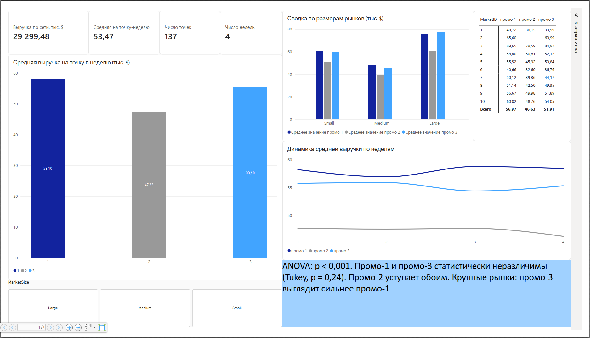

# 📊 Оценка эффективности маркетинговых кампаний (A/B/C-тест)

Анализ результатов 4-недельного A/B/C-теста трех промо-акций в сети ресторанов быстрого питания. Цель исследования — определить, какая рекламная кампания приносит наибольшую выручку и статистически значимо превосходит остальные.



---

## 🎯 Бизнес-задача
Сеть планирует масштабный запуск новой промо-кампании и протестировала 3 механики продвижения (`Promotion 1`, `Promotion 2`, `Promotion 3`) на **137 торговых точках** в течение **4 недель** (всего 548 наблюдений). 

**Ключевые вопросы:**
1. Есть ли статистически значимая разница в средней недельной выручке между тремя акциями?
2. Какую из кампаний следует масштабировать на всю сеть?
3. Отличается ли эффективность акций на рынках разного размера (`Small`, `Medium`, `Large`)?

---

## 💡 Главные выводы и рекомендации для бизнеса

* **Промо-2 — явный аутсайдер (отклонить):** Средняя выручка на точку в неделю составила **\$47,33 тыс.**, что на **18,5% ниже**, чем у Промо-1 (\$58,10 тыс.), и на **14,5% ниже**, чем у Промо-3 (\$55,36 тыс.). Разница статистически значима (p < 0.001).
* **Промо-1 и Промо-3 статистически неразличимы:** Несмотря на то что Промо-1 лидирует по среднему значению (\$58,10 тыс. против \$55,36 тыс.), попарный тест Тьюки показал p-adj = 0.24 (> 0.05). Это значит, что разница между ними находится в пределах статистической погрешности.
* **Что масштабировать:** Рекомендуется отказаться от Промо-2 и выбирать между **Промо-1** и **Промо-3** исходя из стоимости запуска каждой кампании (ROI). При равных затратах приоритет стоит отдать **Промо-1**, так как она показывает более стабильный результат во времени, однако для **крупных рынков (Large)** стоит дополнительно протестировать **Промо-3**, где она показывает сильную динамику.

---

## 🔬 Методология и ход исследования

1. **Разведка и валидация данных (EDA):**
   * Пропуски и дубликаты отсутствуют.
   * Проверена сбалансированность групп: распределение по размерам рынков (`Small`, `Medium`, `Large`) и возрасту торговых точек (`AgeOfStore`) равномерно во всех трех группах.
2. **Статистическое тестирование:**
   * Использован однофакторный дисперсионный анализ (**ANOVA**), так как сравниваются 3 независимые группы. Результат: F = 21.95, p < 0.001 (на уровне всех наблюдений).
   * **Учет повторных измерений:** Поскольку каждая из 137 точек замерялась 4 раза (понедельно), дополнительно проведен тест ANOVA на агрегированных средних по точкам (`LocationID`). Результат подтвердился: **F = 5.85, p = 0.0037**.
   * Для выявления конкретных пар-победителей применен критерий **Tukey HSD** с поправкой на множественные сравнения (защита от ложноположительных выводов).
3. **Визуализация:**
   * Данные очищены в Power Query (исправлены типы данных и заголовки).
   * Собран интерактивный дашборд в **Power BI** с единой цветовой кодировкой лидеров и фильтрацией по размеру рынка.

---

## 🛠 Стек технологий
* **Python (`pandas`, `scipy`, `statsmodels`)** — очистка данных, проверка баланса сплитования, проведение тестов ANOVA и Tukey HSD.
* **Power BI (Power Query, DAX)** — подготовка витрины данных и построение интерактивного отчета.
* **Jupyter Notebook** — документация исследования и воспроизводимый код.

---

## 📁 Структура репозитория
```text
├── data/
│   └── WA_Marketing-Campaign.csv   # Исходный датасет (Kaggle)
├── notebooks/
│   └── ab_test_analysis.ipynb      # Ноутбук с расчетами, графиками и выводами
├── dashboard/
│   ├── campaign_dashboard.pbix     # Исходный файл Power BI
│   └── dashboard_preview.png       # Скриншот дашборда
└── README.md                       # Описание проекта и бизнес-выводы
```

---

## 📎 Источник данных
Датасет взят с платформы Kaggle: [Fast Food Marketing Campaign A\B Test](https://kaggle.com).


